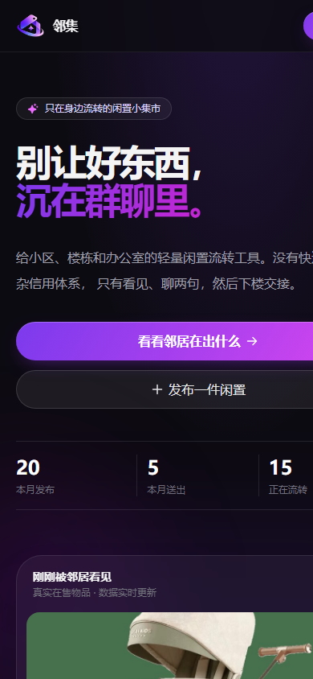
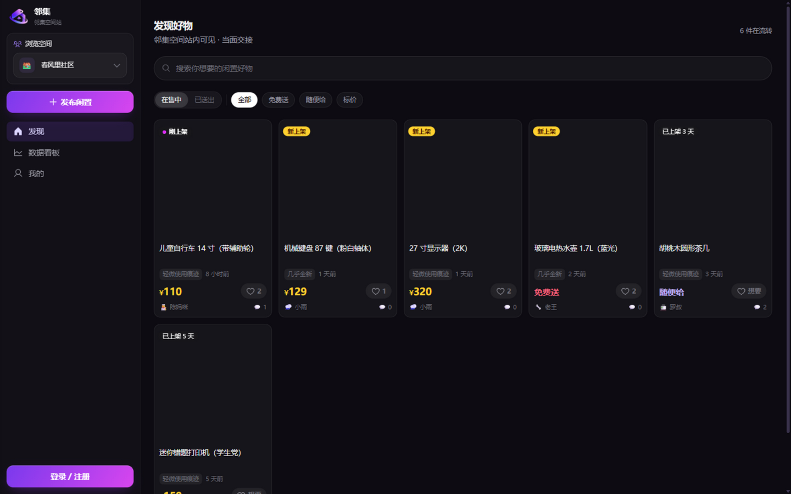
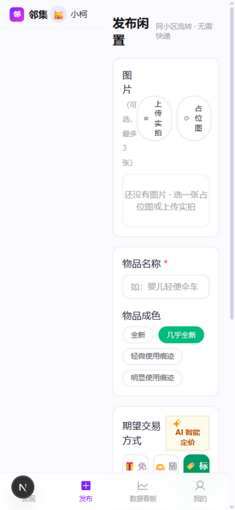
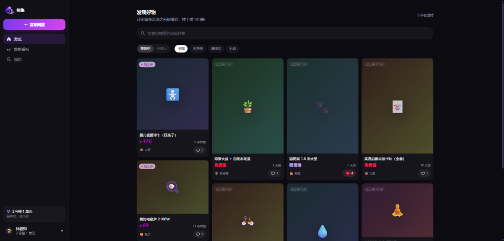

# 邻集 🏘️ — 小区闲置物品流转工具

> 让闲置物品在沉没之前被看到。

小区微信群里，婴儿车、电磁炉、绘本、绿植的转让消息刷得太快，还没被看到就沉了；想送的东西不知道怎么定价；买卖双方还要私聊约时间约地点。「邻集」是一个**专门给小区/楼栋/办公室内部用**的轻量闲置流转工具：熟人社区不需要信用体系，楼上楼下不需要快递，最重要的是**信息流足够新鲜、流转足够快**。

视觉采用**紫夜 + 暗玻璃**风格：`/` 用真实在售物品与社区数据直接说明产品价值，点“进入邻集”到达应用（信息流在 `/discover`，桌面侧栏 + 移动底栏）。

| | |
| --- | --- |
|  |  |
|  |  |

---

## 一、快速开始

```bash
npm install
npm run setup     # 初始化 SQLite 数据库 + 灌入种子数据（5 位邻居、15 件物品）
npm run dev       # 启动，访问 http://localhost:3000
```

### 多空间数据隔离

同一套邻集可以包含多个小区、楼栋或办公室。用户注册时只能选择已开通空间；新空间需要先提交名称、类型、联系方式和申请说明，由平台管理员审核通过后才会进入注册列表。登录后只能浏览和操作所属空间的商品、留言与看板数据，未登录用户可在侧栏切换想浏览的空间。

`.env` 中配置的是整个平台的公共名称：

```env
NEXT_PUBLIC_SITE_NAME="邻集空间站"
NEXT_PUBLIC_SITE_TYPE="社区空间"
```

**接入 LLM（可选）**：复制 `.env.example` 的配置，在 `.env` 中填入 API Key 即可启用真实的智能定价 / 文案润色 / FAQ 回复。默认是 Z.ai GLM：

```env
LLM_BASE_URL="https://api.z.ai/api/paas/v4"
LLM_API_KEY="你的 API Key"
LLM_MODEL="glm-4.5-flash"
LLM_PROVIDER_NAME="GLM"
```

切换 DeepSeek 时无需改代码：

```env
LLM_BASE_URL="https://api.deepseek.com"
LLM_API_KEY="你的 DeepSeek API Key"
LLM_MODEL="deepseek-chat"
LLM_PROVIDER_NAME="DeepSeek"
```

> 不填 Key 或模型调用失败时，三个 LLM 功能自动降级为内置规则，保证主要流程可继续使用。服务端统一使用 OpenAI 兼容的 `chat/completions` 协议。

**演示账号**（密码均为 `123456`）：平台管理员 `admin`；普通成员 `acheng` / `daxiong` / `lin` / `xiaoke` / `taozi`。只有管理员能审核空间申请；浏览无需登录，发布、想要、留言、标记送出需登录。

## 二、功能清单（对照考题）

| 模块 | 实现 |
| --- | --- |
| **1. 物品发布** | 名称 / 描述 / 期望交易方式（免费送·随便给·标价）/ 成色 / 图片（emoji 占位图 或 实拍上传，最多 3 张）；新鲜度标识：24h 内"刚上架"（呼吸点动效）、72h 内"新上架"、之后"已上架 X 天"；发布者可"标记已送出"→ 归档保留记录（可记录送给了谁） |
| **2. 浏览与检索** | 卡片流按新鲜度排序（越新越靠前）；交易方式筛选；名称/描述关键词搜索（防抖）；"在售中 / 已送出"归档页签，归档物品只读 |
| **3. 意向与沟通** | "想要"一键表达（乐观更新、可取消）；发布者看到"谁想要"名单；双方确认后在弹窗中选择接收人并标记送出，系统自动记录成交时间；每件物品公开留言板（"楼主"徽章），支持**楼层内回复**（点"回复"可针对某条留言应答，展示"回复 @某人"，回复自动归入所在楼层），避免重复私聊 |
| **4. 数据看板** | 本月发布数 / 本月成交数 / 当前在售数；**近 14 天流转趋势**双折线图；“最快被领走的物品”（发布→标记送出耗时最短 Top3）；“最想要的物品”（想要人数最多且未成交 Top3） |
| **5. LLM 能力** | ① 智能定价建议：输入名称描述 → 返回定价区间或"建议免费送"判断 + 理由；② 物品描述优化：粗糙描述 → 有温度的转让文案；③ 交易 FAQ 自动回复：针对"还在吗/几成新/能自提吗/能便宜点吗"生成回复建议，填入输入框可编辑后发送 |

## 三、技术栈简介

| 层 | 选型 | 为什么 |
| --- | --- | --- |
| 前端 | **Next.js 16（App Router）+ React 19 + TypeScript + Tailwind CSS v4** | 移动端优先的响应式 UI，卡片流 + 底部 Tab 导航贴合"刷小区群"的场景；全 TS 保证前后端类型一致 |
| 后端 | **Next.js Route Handlers（REST API）** | `/api/*` 独立成层，前端只通过 JSON API 通信，**前后端解耦**；查询/校验逻辑集中在 `src/lib`，不与页面耦合 |
| ORM / 数据库 | **Prisma 6 + SQLite** | Schema 即文档；`prisma db push` 一条命令建库，零部署成本，本地演示最友好 |
| LLM | **GLM / DeepSeek（OpenAI 兼容接口）+ Mock 降级** | 统一 `chat.completions` 协议，Provider 可配置；失败/未配置自动降级，可用性优先 |
| 上传 | 本地 `public/uploads` | 考试场景够用；生产可换 S3/OSS，只需替换 `/api/upload` 一处 |

### 架构

```
┌─────────────────────────────  Next.js 16  ─────────────────────────────┐
│  前端（React 19 客户端组件）                                            │
│    首页信息流 / 物品详情 / 发布 / 数据看板 / 我的                        │
│         │  fetch JSON（/api/*）              │ Server 端读取会话 Cookie │
│  ▼                                                                        │
│  API 层（Route Handlers，REST）                                           │
│    /api/items  /api/items/[id]  /api/items/[id]/want|comments            │
│    /api/stats  /api/auth  /api/upload                                 │
│    /api/llm/price  /api/llm/polish  /api/llm/reply                       │
│         │ Prisma Client                       │ fetch（OpenAI 兼容）     │
│  ▼                                            ▼                          │
│  SQLite（prisma/dev.db）                 GLM / DeepSeek / Mock 降级     │
└──────────────────────────────────────────────────────────────────────────┘
```

### API 一览

| 方法 & 路径 | 说明 |
| --- | --- |
| `GET /api/items?q=&mode=&status=&mine=1&wanted=1` | 列表：搜索 / 交易方式筛选 / 归档 / 我发布的 / 我想要的 |
| `POST /api/items` | 发布物品（服务端校验） |
| `GET /api/items/[id]` | 详情：发布者、想要名单、留言 |
| `PATCH /api/items/[id]` | 标记已送出（仅发布者，记录 givenAt / givenTo） |
| `POST /api/items/[id]/want` | 表达/取消“想要”（幂等切换） |
| `POST /api/items/[id]/comments` | 公开留言；本人可撤回自己的留言，保留楼层和其他人的回复 |
| `GET /api/stats` | 看板：月度数据 + 最快被领走 + 最想要 |
| `POST/PUT/PATCH/DELETE /api/auth` | 注册 / 登录 / 编辑个人资料 / 退出（bcrypt + HMAC 签名 httpOnly Cookie，7 天） |
| `POST /api/upload` | 图片上传（≤5MB，JPG/PNG/WebP/GIF） |
| `POST /api/llm/price · polish · reply` | 三个 LLM 能力，响应带 `source: llm \| mock` 与 `provider` |

### 数据库设计

ER 图见 [`docs/er.md`](docs/er.md)（含 Mermaid 图）。六张核心表：

- **Space** 独立的小区、楼栋或办公室（所有业务查询按空间隔离）
- **SpaceApplication** 新空间申请（待审核 / 已通过 / 已拒绝）
- **User** 空间成员（所属空间 / 昵称 / emoji 头像 / 所在位置 / 一句话简介）
- **Item** 物品（交易方式、成色、价格、图片 JSON、状态；`createdAt` 驱动新鲜度，`givenAt - createdAt` 驱动"最快被领走"）
- **Want** "想要"意向（itemId+userId 唯一约束，防重复点击）
- **Comment** 物品留言（公开问答）

设计取舍：**交易本身发生在线下**（楼上楼下自提），线上只保留轻记录——"已送出"用 Item 状态字段 + 时间戳表达，不建独立的订单表，避免过度设计；归档物品保留完整记录支撑看板统计。

## 四、产品与 UI 取舍

- **移动端优先**：小区场景人人用手机刷；桌面端自动切换为多列网格 + 顶部导航。
- **轻量认证**：bcrypt 密码哈希 + HMAC 签名 httpOnly Cookie，双视角演示改为双账号登录展示；浏览保持公开，操作需登录。
- **占位图方案**：色相渐变 + emoji 生成的占位图任意尺寸清晰、风格统一，也支持实拍上传。
- **新鲜度前置**：卡片左上角的新鲜度徽章是信息流的第一优先级——这是产品命题"在沉没之前被看到"的直接表达。

## 五、目录结构

```
prisma/            schema.prisma + seed.ts（幂等种子数据）
src/lib/           db / session / llm / items（查询与校验）/ constants（前后端共用类型）
src/app/api/       REST API（Route Handlers）
src/app/           页面：/ 首页 · /items/[id] 详情 · /publish 发布 · /dashboard 看板 · /my 我的
src/components/    卡片、徽章、留言板、想要按钮、会话与 Toast 等
docs/              er.md（数据库 ER 图）· video-script.md（5 分钟视频讲稿）
```

## 六、部署（加分项）

完整步骤见 [DEPLOY.md](DEPLOY.md)：阿里云 ECS（学生代金券）+ GitHub 托管 + pm2，SQLite 原样部署零迁移，十分钟上线公网可访问的站点。
