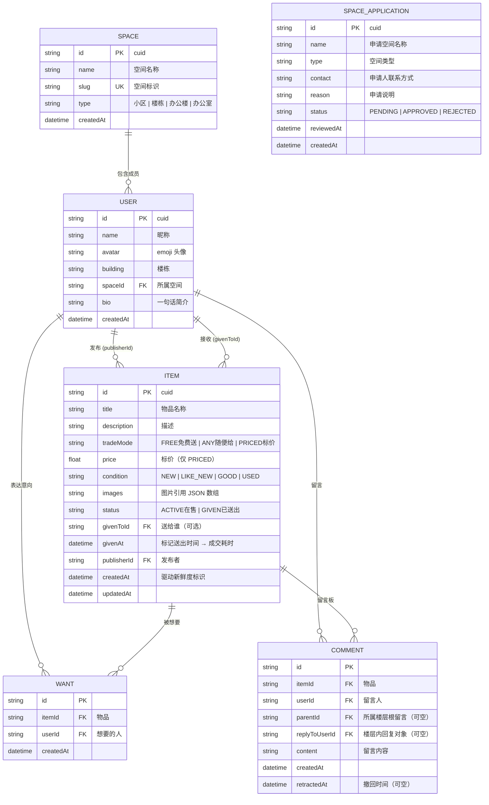

# 「邻集」数据库 ER 图

> 数据源：`prisma/schema.prisma`（Prisma 6 + SQLite）

## Mermaid ER 图

## 表说明

| 表 | 作用 | 关键设计 |
| --- | --- | --- |
| **Space** | 独立的小区、楼栋或办公空间 | 同一网站可包含多个空间；列表、详情、留言、意向和看板查询统一按 `spaceId` 隔离 |
| **SpaceApplication** | 新空间开通申请 | 普通用户只能提交申请；平台管理员审核通过时才创建 Space，避免重复或虚假社区 |
| **User** | 空间成员账号（登录后即身份） | username 唯一 + bcrypt passwordHash；每位用户固定属于一个 Space。同一用户通过两个命名关系（PublishedItems / ReceivedItems）同时承担"发布者"和"接收者"角色 |
| **Item** | 闲置物品主表 | `tradeMode` 用受控枚举字符串而非布尔，天然支持"免费送 / 随便给 / 标价"三种语义；`status = GIVEN` 即归档，**保留记录**支撑看板；`createdAt` 计算"刚上架/新上架/已上架 X 天"新鲜度；`givenAt - createdAt` 计算"最快被领走" |
| **Want** | "想要"意向 | `@@unique([itemId, userId])` 保证一人一物最多一次，接口层做幂等切换（再点取消） |
| **Comment** | 围绕物品的公开留言问答 | 与物品级联删除；自关联 `parentId` 实现**楼层回复**（回复统一挂到楼层根，避免无限嵌套），`replyToUserId` 记录楼层内回复对象用于展示"回复 @某人"；本人撤回时清空内容并记录 `retractedAt`，保留楼层和其他人的回复 |

## 索引

- `Item(status, createdAt)`：首页信息流"在售 + 按新鲜度倒序"的高频查询
- `User(spaceId)`：快速限定当前空间成员及其物品
- `Item(publisherId)`："我发布的"
- `Want(itemId, userId)` 唯一索引：幂等切换 + 防重复意向
- `Want(itemId)` / `Comment(itemId)`：详情页聚合"想要人数"与留言列表
- `Comment(parentId)`：按楼层聚合回复列表

## 取舍说明

交易发生在当前空间内（当面交接），线上只保留**轻记录**：成交用 `Item.status + givenAt (+ givenToId)` 表达，不引入独立的 Order/Transaction 表；信用体系、支付、物流均不在最小可用范围内。空间隔离由服务端查询统一执行，不能仅依赖前端筛选。
